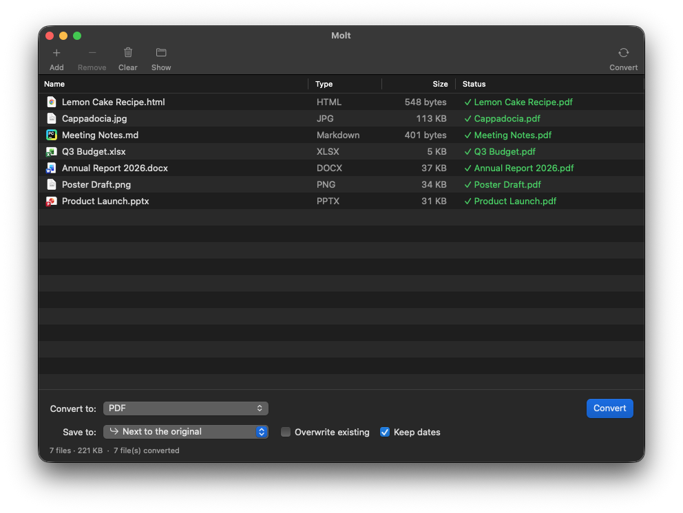
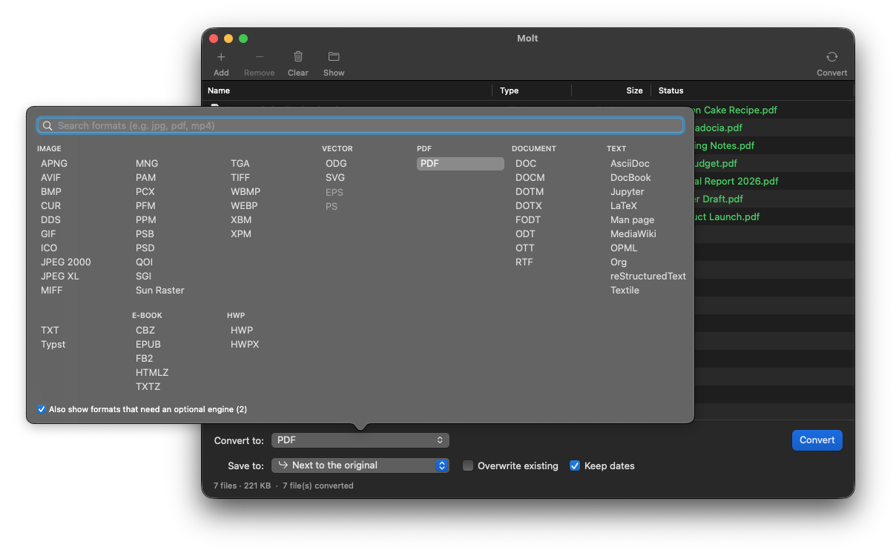

<p align="center">
  
</p>

<h1 align="center">Molt for Mac</h1>

<p align="center">
  Native macOS file converter, powered by <a href="https://github.com/KnifeLemon/Filee">Filee</a>.<br>
  <em>A snake molts and stays the same snake; a file changes its format and keeps its content.</em>
</p>

<p align="center">
  <a href="https://github.com/yavuzmeteafsar/molt-mac/releases/latest"></a>
  
  
  <a href="LICENSE"></a>
</p>

<p align="center">
  
</p>

Drop files into a window, pick a target format, press **Convert**. Images, PDF, Word, Excel, PowerPoint, e-books,
fonts, CAD, 3D models and more, all offline.

[🇹🇷 Türkçe](README.tr.md)

<p align="center">
  
</p>

## Built on Filee

Molt does not convert anything itself. Every conversion is done by **[Filee](https://github.com/KnifeLemon/Filee)**,
the open-source converter by Myeonggu Kim (KnifeLemon), released under the MIT license. Molt ships Filee's
conversion engine (its command-line tool and the libraries it uses) inside the app and puts a native AppKit window
in front of it. Filee's own app is not required.

What Molt adds:

- A classic Mac window instead of Filee's radial menu at the cursor: a file list with per-file status,
  a format picker laid out in columns with search, a progress sheet with a log
- **Convert with Molt** in Finder's right-click menu (under Quick Actions or Services): select files, right-click,
  and they open in Molt
- Archives (RAR, ZIP, 7Z, TAR, ISO and more) extracted the way Finder does: no extra wrapper folder around a single
  item, no `__MACOSX` leftovers
- No Accessibility or Finder Automation permissions; Molt never watches system-wide drag gestures
- English and Turkish interface

If you are on Windows or Linux, or prefer the drag-and-drop donut, use Filee directly.

## Install

Download the DMG for your Mac from [Releases](../../releases/latest):

- `Molt-<version>-arm64.dmg` for Apple Silicon (M1 and newer)
- `Molt-<version>-x86_64.dmg` for Intel Macs

Open it and drag **Molt** to **Applications**. macOS 13 Ventura or newer is required.

Molt is ad-hoc signed and not notarized (that needs a paid Apple Developer membership). The first time, macOS will
refuse to open it: open **System Settings → Privacy & Security**, scroll down and click **Open Anyway**.

If **Convert with Molt** doesn't show up after the first launch, turn it on in **System Settings → Keyboard →
Keyboard Shortcuts → Services → Files and Folders**.

## Optional engines

Most conversions work out of the box. A few need a larger program that Filee looks for on your Mac:

| Engine | Unlocks | Install |
| --- | --- | --- |
| LibreOffice | DOC, RTF, ODT, PPT and other older office formats; correct PDF output for Turkish, Arabic and other non-Latin-1 text | `brew install --cask libreoffice` |
| FFmpeg | All video and audio | `brew install ffmpeg` |
| Pandoc | Markdown, LaTeX and other markup ↔ DOCX/ODT, DOCX → PPTX slides | `brew install pandoc` |
| Ghostscript | EPS / PS | `brew install ghostscript` |
| calibre | MOBI, AZW3 and rarer e-book formats | `brew install --cask calibre` |

Restart Molt after installing one. Formats that need a missing engine are hidden in the picker, or shown greyed out
with **Also show formats that need an optional engine**.

## How it works

Molt runs Filee's command-line tool as a child process, the way archive front ends wrap `unrar` or `7zz`:

| Step | Filee command | What Molt does with it |
| --- | --- | --- |
| Launch | `filee formats` | Builds the extension → format table |
| Files added | `filee formats <id>` | Lists each format's targets and intersects them for the selection |
| Convert | `filee convert <files> --to <id> [-o dir] [--quality n] [--overwrite] [--keep-dates]` | Reads Filee's per-file `ok` / `fail` / `skip` lines as they are printed and updates the table and the progress sheet live |
| Stop | `SIGINT` | The same as Ctrl+C in a terminal; Filee cancels cleanly |

Filee's `--json` output was not used on purpose: it arrives once, after the whole batch, while the line output gives
per-file progress during a long batch.

## Build from source

Requirements: macOS 13+, Xcode Command Line Tools (`xcode-select --install`).

```sh
git clone --recurse-submodules https://github.com/<you>/molt-mac.git
cd molt-mac
sh build.sh run
```

This builds the app without an embedded engine. It then uses a Filee installed with Filee's own `install.sh`
(`~/.local/bin/filee`), or one chosen from **Molt → Locate Filee…**.

To embed the engine as the release does, you also need the .NET 10 SDK and PowerShell (`brew install dotnet powershell`):

```sh
sh scripts/embed-engine.sh osx-arm64
ENGINE_DIR=build/engine-osx-arm64/cli sh build.sh run
```

Releases are built by [GitHub Actions](.github/workflows/release.yml) on every `v*` tag, for both architectures.

## Project layout

```
Sources/FileeEngine.swift          locating Filee, parsing its format lists, running conversions
Sources/MainWindowController.swift main window: toolbar, file table, output options
Sources/FormatPicker.swift         the column-based format picker
Sources/Views.swift                drop zone and progress sheet
Sources/AppDelegate.swift          menus, About panel, app lifecycle
Sources/Localization.swift         English and Turkish strings (MOLT_LANG=tr|en overrides the system language)
scripts/embed-engine.sh            builds Filee's CLI from the submodule and fetches its bundled engines
scripts/make-dmg.sh                packages the app into a DMG
vendor/Filee                       Filee, as a git submodule pinned to a release tag
```

## Credits and licenses

- **[Filee](https://github.com/KnifeLemon/Filee)** © Myeonggu Kim (KnifeLemon) and Filee contributors, MIT.
  The conversion engine. Its license and third-party notices (ImageMagick, PDFium, SkiaSharp, rhwp, 7-Zip and
  others) are included in the app under `Contents/Resources/Licenses` and in [vendor/Filee](vendor/Filee).
- **[MacRAR](https://github.com/mstcvk/MacRAR)** by Mesut Çevik, MIT. Inspiration for the window layout and the
  approach of wrapping a command-line engine in a native app.

Molt is not affiliated with or endorsed by the Filee project.

Molt's own code is released under the MIT license, see [LICENSE](LICENSE).
